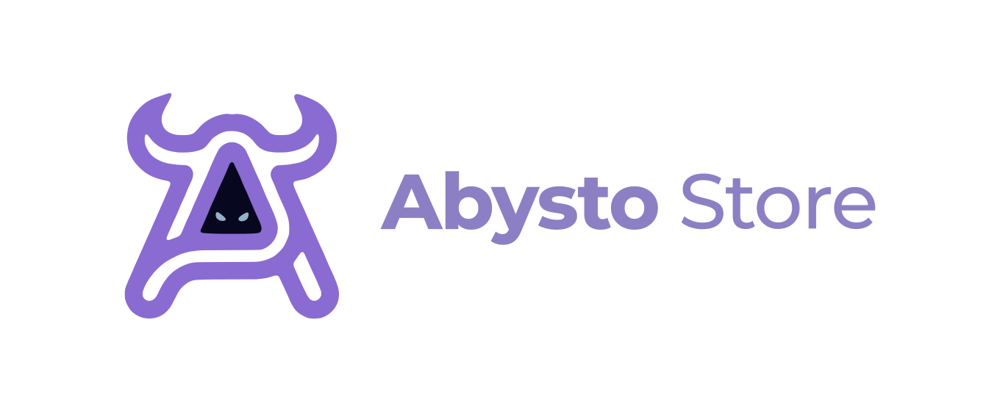

  

  Extensions for Magento Open Source and Adobe Commerce.

---

### What we build

Admin-friendly Magento 2 extensions that follow the Magento coding standard, ship with tests, and work with [Hyvä](https://github.com/hyva-themes/magento2-default-theme) and [GraphQL](https://developer.adobe.com/commerce/webapi/graphql/) storefronts through optional add-ons.

### Compatibility

Every Abysto extension supports the Magento lines Adobe still supports, plus the two lines before them: today **[Magento Open Source](https://github.com/magento/magento2) and Adobe Commerce 2.4.5 and later**.

They also work on **[Mage-OS](https://github.com/mage-os/mageos-magento2) 1.0 and later**, the releases built on those Magento lines.

### Installation

Extensions are installed with Composer from the Abysto repository, with the access keys from your Abysto account.

### Security

Published security advisories are shown in the Magento admin of every store that runs an affected version.
